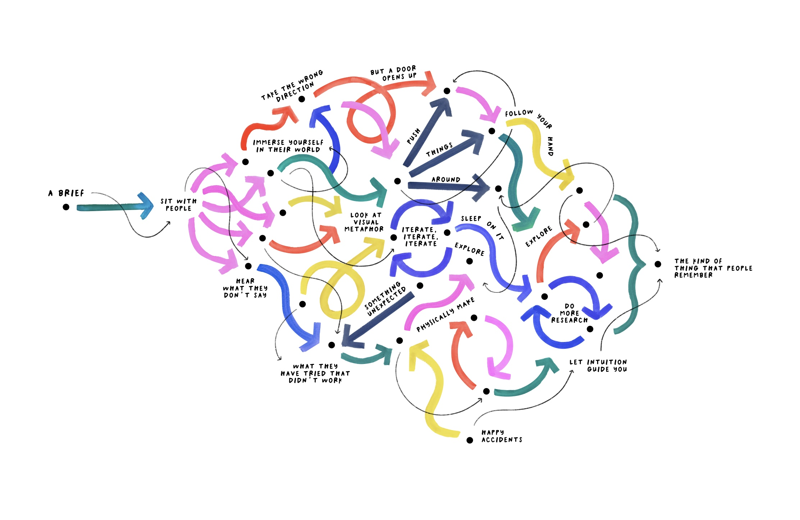
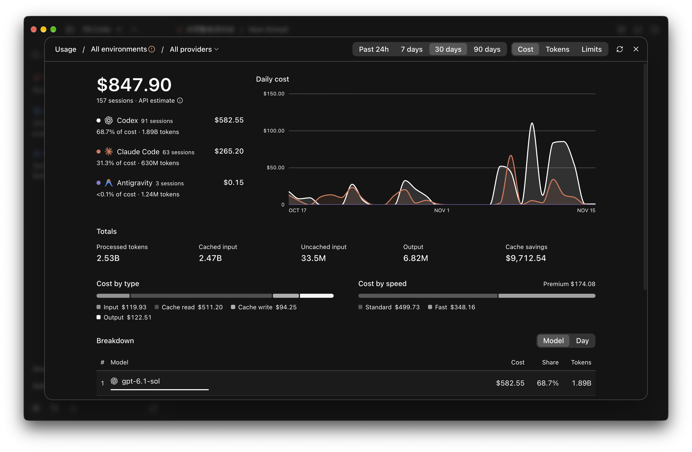

週末看到一篇紐時的評論[In Defense of The Detour](https://www.nytimes.com/interactive/2026/09/27/opinion/ai-art-creativity.html)，看著看著我的記事本中已經貼滿了金句，突然好有動力，晚上衝去附近的深夜咖啡廳，分享文章中的quote跟整理我自己的思緒。

---

雖然現在名片上寫著資料工程師，但我一直以來都不是典型工程師，別人問我做什麼我都說「哦就是做網頁的」，比較熟的就會說我在瞎搞。我不曾在有PM的產品團隊工作過，一直以來ticket都是我自己寫自己看或是寫給別人的，數位產品從PO（Product Owner）、PM、設計、工程師到行銷一條龍做完（整個就是在瞎搞）。但正因如此，我培養出了一個做產品想很多的個性和堅持（有時候或許想太多了）。

我很喜歡所謂「工程師的三大美德（[Three virtues of a Programmer](https://thethreevirtues.com/)）」：傲慢（hubris）、懶惰（laziness）、沒耐心（impatience），尤其是傲慢。我傾向把這點解讀為一種「我就是做得到」的偏執，正是因為這樣的不甘心，讓我在面對一個需求與解決問題的時候，不只是票來就接，而是有更多的探索，在過程中找到快樂（雖然最後都比預期花了更多時間，但我也真心覺得成果是我所愛，想要與他人分享的）。

工作經驗中跟很多不同企業的工程師、研究員、工程主管或PM聊過天，最投緣的都是那種講到他做過的東西，就會開始TMI（好的那種，不是教教男），連每個按鈕為什麼放在這裡，都可以如數家珍，說出背景故事的人。總覺得現在可以這樣對話的人愈來愈少了。

在前一份工作中，我是組織裡面那個工程師兼PM兼設計兼Whatever，面對同事的需求，最常說的一句話是「技術上當然可以，但為什麼要？」這時候具有技術能力的我，往往可以「就是不要做」而擋下這些不成熟的需求進到工程端。這不代表我是不回應同事需求的機車PM，而是靠這個去買一些時間進一步了解與拆解問題。最後這些需求都好好被滿足，但都不是原本提需求者想的方式，甚至解決的問題都不一樣。但當AI出現之後，地方PM與工程師們似乎已經很難擋下這類的需求，因為AI可以快速地做出一個半成品來滿足未經思考過的需求，或許這就是所謂的「試錯」。（雖然我覺得可以自信一點，把「試」拿掉）

AI出現後，因為這些玩具實在太像成品了，我們太容易把眼睛瞇起來，用半成品當成基準點，半推半就地就往下討論了。似乎已經沒有人在問「為什麼這裡要放這個？我們在解決什麼問題？」就算問了，得到的回覆也多半是「不知道欸，AI建議我的，如果不適合就拿掉或是之後再討論吧。」AI出現之後，以前一磚一瓦做加法建立功能的時間，其實並沒有消失，只是變成了不斷重新思考必要性的「減法」。但這就是沉沒成本的問題，人往往會因為「已經在了」，讓這些食之無味、棄之可惜的AI slop留在成果的某處，小至程式碼裡面一個無謂的檢查、大至首頁上充斥的AI過度說明。這些現象似乎已經逐漸消磨起初把我帶進軟體、且持續給我動力的那種對微小細節的偏執。

> When we reach for the wrong tools too quickly, we eliminate the part of the process where our particular experience and point of view enter the work.

## 後退一步、向前三步

> The greatest contributions to humanity — art, inventions, even products — show evidence of people who got lost in a problem and came out the other side with an idea they would not have found otherwise. That does not happen by taking a shortcut to the center. It happens in the detours.

最近開始有一些分享跟演講場合，在準備的時候我都會想要從過去做題目的經驗中，總結出「我怎麼想到要這樣做」，也常常有人問我是從哪裡找到研究方法。我發現我其實非常難統整出一個邏輯或SOP，因為我解決問題的方式，就像這篇文章所說的，都是在解bug、看文件的時候無意逛到的新功能、API或其他人分享的相似議題文章，很興奮地想要往下鑽，才出現了那個關鍵性的AHA moment解決問題。

我很喜歡底下這張圖，說明了人類在解決一個創新問題時的非線性，我們會走錯很多路，但也會在其中發現我們從未想到的世界，那或許就是最終解決問題的關鍵。我在做[水污染調查](https://www.youtube.com/watch?v=OFPd7Cj8XQE)的時候，蒐集了很多資料但都找不到一個適合研究方法，在撞牆的時候看到畫製河川流向圖的教學文章，"But a door opens up"我重新複盤思考手上有的資訊跟成果，最終整理出一組有趣的方法論。又或是其實去（2025）年5月我就研究出一套機器視覺演算法（無AI），將國防部每日更新的即時軍事動態自動定位、轉化成地理座標，那也是在很多未成熟想法中"Sleep on it"，隔天起來發現Stackoverflow上面有人在討論怎麼把農業歷史地圖轉成分區座標，看似完全不相關，但死馬當活馬醫我就把看到的古老斷線修補圖像處理演算法（對我喜歡用古老簡單的技術），應用在國防部圖檔上，不小心遇到"Happy accident"就成功了

以前我不管做出什麼，都會迫不及待地第一個傳給伴侶分享，TMI的程度大概是到他會說「我被你的訊息洗版」或「看不完」。但最近跟伴侶聊天的時候，他問我最近是不是都在做比較大型的計畫，比較少完成的小專案，我回想了一下，發現近期其實完成了很多工作與新的嘗試，但好像愈來愈少令我覺得興奮、想要和伴侶分享的成就了。

## 我並不討厭或排斥AI

看到這裡你可能覺得我就是討厭或不認同AI，我身邊也很多人這樣覺得。但事實上我用以前研究Javascript前端框架的熱忱（我就說我是做網頁的吧LOL）在實驗AI工作流，每個月都可以用掉近USD$1,000等值的Token，也真的嘗試一天開25個PR迭代新產品。從OpenCode用到多台機器跑T3 Code，我覺得我在AI Bro與AI Sis的世界中應該不算有缺席。況且我也覺得我稱不上什麼堅持手搓的老師傅，我現在也不是每一行程式碼都看，有些slop code我也會放過自己、也放過Codex，想著之後再開一個新的對話refactor。

說了這麼多，還附上AI用量人權圖，我想表達的是（至少現在的）我並不反對AI工具的出現與使用，我感到惋惜的是紐時這篇評輪提到的"Shortcut"。面對AI可以快速實現很多人的想法，我們接受的論述都是，它們（AI）解放了人類的時間可以去做更多思考與有意義的事情，但事實上要能夠有創新的點子出現，最不需要的就是「代理」。代理雖然幫我省下了許多時間，但也省略了很多經驗，並無法讓我遇到更多「意外」。沒有這些獨特的人生經歷與痛苦的撞牆過程，再多的想法都只會是已知的重現，或他人經歷的重播。我猜這也是為什麼大家的Vibe Coding "Hello World"專案，都是逐字稿轉錄工具或某種PDF生成器吧！

> They (AI agents) produce responses that may be of novel use but struggle to depart from patterns found in or interpreted in existing materials and ideas.

**痛苦是必經之路？**

寫著寫著覺得，這就好像電影《命運好好玩》裡面的人生遙控器（這部電影上映的時候我兩歲，但神奇的是我有看過），遙控器雖然快轉了許多人生中無聊的通勤時間、痛苦的生病與伴侶的爭吵，但最後主角發現自己也錯過了人生中許多重要的決定和與家人相處的時光。AI幫我們快轉「以前要拉好幾個會議找PM、工程師來」的規劃與實作時，雖然減少了很多「痛苦」，但會不會也跳過了太多經驗，少了特殊的地方與發揮創意之處呢？

沒有這些痛苦跟經驗，就不會有「意外」來讓我們發現新的事物、「原來還可以這樣」，進而帶來幾次的實驗與真正的創新。就像開頭提到的紐時評論副標題所說，"AI Shortcuts Are Ruining How We Think."

最近還聽了數學家Steven Strogatz在紐時《The Daily》[Podcast](https://www.nytimes.com/2026/10/13/podcasts/the-daily/mathematicians-problem-ai-jobs.html)談Open AI公布數學證明的影響，聽到在數學界中有些學者會刻意留「一看就覺得大概解得出來」的題目不去證明，留給新進研究者或學生來做，培養他們對數學的興趣和成就感。作為想太多的Gen Z，也覺得在AI工具的發展之下，我以前所愛的軟體好像已經找不到成就感跟連結性了，就算是建立自己的AI流程，總覺得好像不是我的，成就趕來得快去得也快。這樣我們還可以培養出對軟體有熱忱的Junior工程師嗎？

現在這個個人網站也是我某個週末想要學Figma畫出來的，一直以來認同為偏前端工程師的我，最後居然不想寫前端，連上Figma MCP讓AI把這個網頁實作出來。在這個經歷中，我似乎完全不在乎我沒有親手寫程式碼，反而是因為自己一筆一畫把頁面拉出來而感到特別快樂。跟設計師朋友分享，他說「果然人是需要創作的」。

最近也剛開始學鉤針，雖然我手真的不是很巧，但鉤針的過程中讓我覺得真實碰到創作的成果，每一個有鬆有緊的結（真的很不平均），雖然不完美，但也都是我親手做出來的。

> Anything worth remembering came from a person who did not know where she or he was going until arriving. No shortcut gets you there: the process leaves a trace.

**後記**

最近在做一個AI的實驗，我想要建立一個資料新聞與圖表視覺化的skill，讓AI可以規則化我們過去的習慣與觀察資料的方式，用了最近很多人討論的hill climbing技巧，讓多個subagent去實測資料做圖表、詮釋與互動式網頁，再給另一個subagent評分以及盲測「這是人做的還是AI做的」，直到達到某個設定的分數指標。經過好幾輪的迭代與數不盡的Token之後，盲測AI依然可以100%分辨哪些是人類製作的內容，哪些是AI做出來的。或許在資料新聞、視覺化的領域中，things are still not "solved."

至於為什麼會看到開頭提到的紐時評論，我其實是在咖啡廳看書（伴侶推薦的《戰爭沒有女人的臉》，好好看！）看到覺得太沉重，中場休息收信讀電子報時，無意看到[The Pudding](https://pudding.cool/)推薦的這篇文章，沒想太多就點進去。一開始甚至因為網路太慢連標題都沒有載入出來，我就滑著頁面看看互動視覺呈現，想著說不定工作上可以應用，沒想到仔細一看覺得跟我一直在反思的事情很像，這或許也回應了人類獨有的"detour"和「無意間」吧！